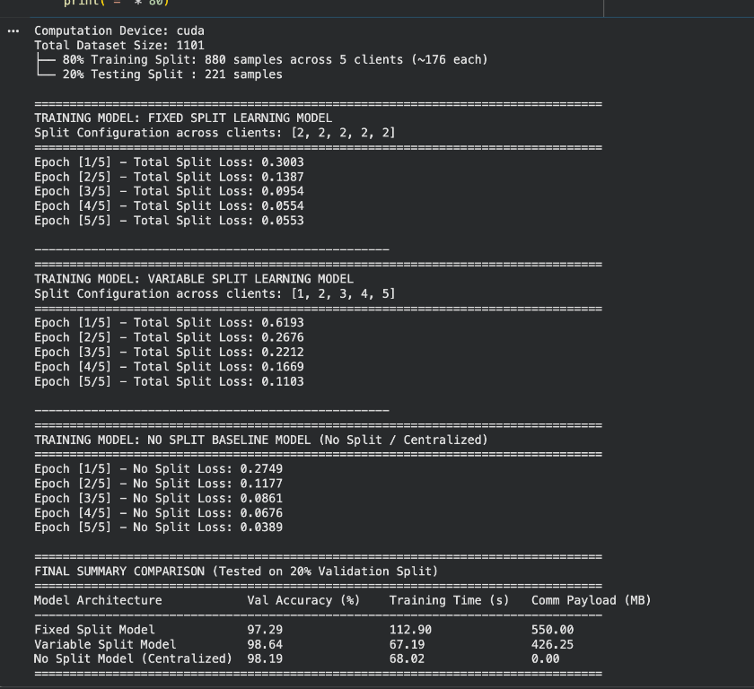

# 🩻 Split Learning for Chest X-ray Classification

An educational Google Colab notebook exploring **split learning** with a convolutional neural network (CNN) to classify chest X-ray images into **NORMAL** and **PNEUMONIA** classes. The experiment compares fixed split points, variable split points across clients, and a no-split baseline.

> ⚠️ This project is for learning and research only. It is not a medical diagnostic tool.

## 🧰 Tech stack


- 🧠 **Deep learning:** PyTorch CNN
- 🖼️ **Image loading and transforms:** TorchVision
- ☁️ **Notebook runtime and dataset storage:** Google Colab and Google Drive
- 🔀 **Learning setup:** Split learning across simulated clients

## 📁 Project contents

- [`MNIST.ipynb`](./MNIST.ipynb) — the notebook for the chest X-ray split-learning experiment. Despite its filename, the notebook uses the chest X-ray dataset.
- `chest_xray/` — a dataset copy may be present locally, but the Colab notebook reads the dataset from your Google Drive.

## 📥 Dataset setup — required

**Dataset source:** [Chest X-Ray Images (Pneumonia) on Kaggle](https://www.kaggle.com/datasets/paultimothymooney/chest-xray-pneumonia).

Before running the notebook, download this dataset from Kaggle and upload the extracted `chest_xray` folder to your own Google Drive. The notebook reads the dataset from your Drive, not from this GitHub repository.

1. Download the dataset from the Kaggle source linked above.
2. Extract the download. It should contain a `chest_xray` folder with `train`, `val`, and `test` directories.
3. In Google Drive, create `My Drive/Chest_Xray/` and upload the extracted **`chest_xray` folder** inside it.
4. Make sure the final Drive path is exactly:

   ```text
   My Drive/
   └── Chest_Xray/
       └── chest_xray/
           ├── train/
           │   ├── NORMAL/
           │   └── PNEUMONIA/
           ├── val/
           │   ├── NORMAL/
           │   └── PNEUMONIA/
           └── test/
               ├── NORMAL/
               └── PNEUMONIA/
   ```

   The folder names and capitalization matter. The notebook expects the dataset at:

   ```text
   /content/drive/MyDrive/Chest_Xray/chest_xray
   ```

## ▶️ Run in Google Colab

1. Open [`MNIST.ipynb`](./MNIST.ipynb) in Google Colab.
2. In Colab, choose **Runtime → Change runtime type** and select a GPU if one is available (optional, but recommended).
3. Run the notebook cells in order.
4. When prompted, authorize Google Drive access so the notebook can read the dataset from the path above.

The notebook loads images from the dataset's `train` directory, creates an 80/20 training/validation split, and distributes the training portion among five simulated clients. It then compares fixed and variable split-point experiments with a no-split baseline.

## 📊 Example results

The screenshot below shows one notebook run on a CUDA-enabled device. In that run, the notebook reported 1,101 samples, split into 880 training samples distributed across five clients and 221 held-out samples. The reported comparison was:

| Model | Split points | Validation accuracy | Training time | Communication payload |
|---|---|---:|---:|---:|
| Fixed split | `[2, 2, 2, 2, 2]` | 97.29% | 112.90 s | 550.00 MB |
| Variable split | `[1, 2, 3, 4, 5]` | 98.64% | 67.19 s | 426.25 MB |
| No-split (centralized) | None | 98.19% | 68.02 s | 0.00 MB |

In this run, the variable-split setup had the highest reported validation accuracy, while the centralized baseline had no split-learning communication payload. These are results from one run, not a guarantee of performance; outcomes can vary with the data split, hardware, and training configuration.



## 📄 Dataset and usage note

**Dataset:** Chest X-Ray Images (Pneumonia), from [Kaggle](https://www.kaggle.com/datasets/paultimothymooney/chest-xray-pneumonia). Follow the dataset's terms of use. This notebook is for educational purposes only; its predictions are not for clinical use.
